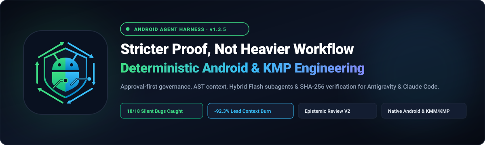
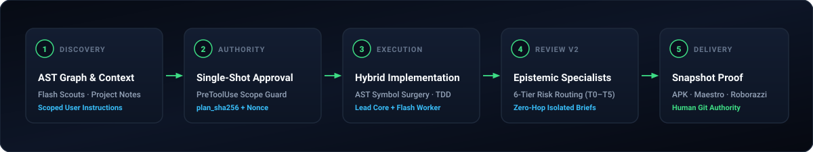

<div align="center">



<br />

[](https://github.com/rabee-elkholy/android-agent-harness/actions/workflows/ci.yml)
[](https://github.com/rabee-elkholy/android-agent-harness/releases)
[](https://pypi.org/project/android-agent-harness/)
[](https://github.com/rabee-elkholy/android-agent-harness/blob/main/docs/compatibility-matrix.md)
[](https://github.com/rabee-elkholy/android-agent-harness/blob/main/docs/compatibility-matrix.md)
[](https://github.com/rabee-elkholy/android-agent-harness/blob/main/docs/compatibility-matrix.md)
[](https://github.com/rabee-elkholy/android-agent-harness/blob/main/LICENSE)
[](https://hub.xerj.org/contributors/rabee-elkholy)

<h3>An approval-first, cryptographically verified engineering layer for AI coding agents on Native Android &amp; Kotlin Multiplatform (KMM / KMP).</h3>

<p>
  <a href="#quick-start"><b>Quick Start</b></a> ·
  <a href="#why-android-agent-harness"><b>Why Harness?</b></a> ·
  <a href="#what-daily-use-looks-like"><b>Daily Workflow</b></a> ·
  <a href="#antigravity-first-architecture--review-protocol-v2"><b>Antigravity &amp; Review V2</b></a> ·
  <a href="#hybrid-flash-orchestration--frontier-quota-protection"><b>Hybrid Models &amp; Quota</b></a> ·
  <a href="#capability-detected-android-ecosystem-bridges--ast-symbol-surgery"><b>Ecosystem Bridges</b></a> ·
  <a href="#measured-performance--context-efficiency"><b>Benchmarks</b></a> ·
  <a href="#faq"><b>FAQ</b></a>
</p>

</div>

---

**Android Agent Harness** turns general-purpose AI coding assistants — primary-first on **Google Antigravity**, plus **Claude Code**, **Codex**, **Cursor**, and `AGENTS.md` hosts — into a disciplined, senior-grade Android and KMM/KMP engineering workflow.

Instead of relying on fragile prompt instructions that decay as chat context grows, the harness moves architectural discovery, scope boundaries, TDD bug reproduction, specialist code review, physical-device QA, and delivery proof into a **zero-dependency Python standard-library runtime** living cleanly under `.agents/`.

> **Core Philosophy — Stricter proof, not heavier daily workflow:** You approve one clear plan, keep 100% authority over Git and external mutations, and receive changes backed by SHA-256 snapshot-bound compile, test, review, and device evidence.

---

## At a Glance: 10 Core Engineering Capabilities

| Capability | Problem Solved | How Android Agent Harness Enforces It |
|---|---|---|
| **1. AST & Symbol Graph Discovery** | Blind grep loops and token-heavy full-file reads across large multi-module repos | Incremental code graph (`graph` & `task-context`) across `Kotlin`, `Java`, `XML`, and `Swift`, surfacing exact line ranges, callers, reuse candidates, and matching tests in `~14 ms`. |
| **2. Single-Approval Scope Guard** | Silent scope creep, unapproved refactors, and repetitive confirmation prompts | One plan approval (`plan_sha256` + single-use nonce) unlocks execution. Native `PreToolUse` hooks (`hooks.json`) block unapproved writes in real time. |
| **3. Multi-Wave Hybrid Flash Delegation** | Burning weekly frontier model quota on file exploration, boilerplate slices, and Gradle loops | Pinned `gemini-3.8-flash-medium` `harness-scout-agent` and `harness-worker-agent` absorb discovery and `T0–T3` slices with hard step caps (`24`/`32`) and Lead anti-reread guards (`<=3` reads). |
| **4. 6-Tier Risk & Epistemic Review V2** | Over-reviewing trivial docs or under-reviewing `Auth` / `Billing` / `Room` changes | Classifies actual diffs from `T0_TRIVIAL` (instant delivery) to `T5_CRITICAL`, dispatching epistemically isolated specialists returning machine-verified `HARNESS_REVIEW_RESULT_V2` verdicts. |
| **5. Android & KMM / KMP Domain Gates** | Room migration crashes, missing `values-*` translations, layer bypasses, and `commonMain` leaks | Deterministic preflight checks for Room schema bumps & migrations, locale string/plural parity, Clean Architecture `UI -> DAO` bypass, Android 15/16 lint, and `commonMain` purity. |
| **6. Persistent Repo Memory (`.agents/project-context/`)** | Repeating team conventions and architectural rules in every new chat | Combines machine-extracted `project-facts.json`, human `project-notes.md`, and scoped `developer-instructions.json` propagated across all `7/7` discovery, planning, worker, and review surfaces. |
| **7. AST Symbol Surgery & Ecosystem Bridges** | Fragile 600-line file edits, RTL clipping missed by unit tests, and noisy repo-wide lint | Built-in declaration-level AST editor (`symbol replace-body`), **Maestro YAML** physical-device runner & exporter, **Roborazzi** headless `.uitree.json` RTL/bounds gate, and diff-scoped **SARIF / BuildHealth / LeakCanary** checks. |
| **8. Cryptographic Snapshot & Device Proof** | Claiming "tests pass" from stale runs before the latest edit | Binds unit tests, reviews, APK artifacts, `device install-start`, and live phone E2E journeys to `delivery_snapshot_sha256` and `change_set_sha256`. Any edit invalidates stale proof. |
| **9. Smart Context Rotation & Task Bridge** | High latency in `100k+`-token chats and re-explaining context across follow-up tasks | Tracks session health, recommends clean rotation boundaries, and transfers contracts, `interface_delta` signatures, and a fresh Discovery Receipt to a new chat via `task bridge`. |
| **10. Universal PM MCP & Self-Healing State** | Accidental ticket closures, overwritten Bug descriptions, or wedged task states | Zero-config discovery for Zoho Sprints/Projects, Jira, Linear, GitHub, ClickUp, Asana, Monday, and Trello with `pm authorize` previews, protected Bug bodies, `task heal` rollback, and Zero-PII forensics. |

---

## Why Android Agent Harness?

AI models write Kotlin and Compose code fast — keeping them aligned with a real, evolving multi-module Android codebase over dozens of turns is the hard part.

| Failure Mode in Vanilla AI Sessions | Deterministic Guarantee with Android Agent Harness |
|---|---|
| **Stale verification**: Agent reports "all tests pass" from a run before its last edit. | Every test, review, APK, and device check is bound to `delivery_snapshot_sha256`. Any later edit marks proof stale and blocks delivery. |
| **Unreproduced bug fixes**: Agent guesses at a fix without proving the bug existed. | Applicable `BUG` tasks enforce `CAPTURE_RED_EVIDENCE` (`--capture-red`) so a failing test reproduces the defect before production code is touched. |
| **Scope drift & drive-by refactors**: Agent edits unrelated modules or modernizes legacy Java/XML unasked. | Local architecture contracts preserve per-module patterns (`MVP`, `MVVM`, `MVI`), and native `PreToolUse` hooks block out-of-scope file mutations. |
| **Self-approved plans & unwanted Git commits**: Agent rubber-stamps its own plan or runs `git commit`/`push`. | Plan approval requires developer words in chat; `commit`, `branch`, `merge`, `rebase`, and `push` remain strictly under **Human Git Authority**. |
| **Frontier quota exhaustion**: Lead model re-reads 800-line files after subagents finish or spawns unpinned explore loops. | Built-in unpinned `research`/`explore` loops are redirected to Flash `harness-scout-agent`, and post-wave Lead re-reads are capped at `<=3` surgical checks. |
| **Context amnesia across chats**: Every new conversation forgets module rules and past architectural decisions. | `project-notes.md` and scoped `developer-instructions.json` live in the repo, automatically rehydrating constraints and checking code-to-doc drift (`context drift-report`). |

---

## Quick Start

### Chat installation (recommended)

Open your Android or KMM/KMP project in **Google Antigravity** (or Claude Code) and paste this single bootstrap prompt:

```text
Read https://raw.githubusercontent.com/rabee-elkholy/android-agent-harness/v1.3.4/docs/install-or-update-prompt.md and follow all instructions.
```

What happens automatically and non-destructively:
1. **Read-only inspection**: Discovers Gradle modules (`:app`, `:composeApp`, `:core:*`, `:feature:*`), flavors, UI toolkits, and locales without modifying a single app file.
2. **Setup preview & approval**: Asks essential project questions, previews the installation plan, and waits for your approval.
3. **Clean isolation**: Stores the pinned kit outside your repo (`~/.android-harness/kit`), installs only the managed runtime under `.agents/`, configures `.git/info/exclude` (zero `git status` noise when gitignored mode is chosen), and verifies installation health via `doctor --install-check`.

### Terminal installation (alternative)

Install globally via `pipx`:

```bash
# 1. Install the standalone CLI
pipx install android-agent-harness

# 2. Initialize inside your Android / KMP repository
android-harness init --repo /path/to/android-project

# 3. Run the 13-dimension health diagnostic
android-harness doctor --repo /path/to/android-project --json
```

Or run directly from a pinned shallow clone with **zero global packages**:

```bash
git clone --depth 1 --branch v1.3.4 --single-branch \
  https://github.com/rabee-elkholy/android-agent-harness.git ~/.android-harness/kit

python ~/.android-harness/kit/harness_cli.py init \
  --repo /path/to/android-project \
  --kit ~/.android-harness/kit
```

Inside an installed repository, all daily operations run through the in-process local launcher:

```bash
python .agents/harness.py doctor --json
```

### Transactional Zero-Clobber Updates

Installed repositories check for newer releases in the background (at most once per day) and provide the exact upgrade command via `python .agents/harness.py update-info`:

```bash
# Update from a pinned tag checkout:
python ~/.android-harness/kit/harness_cli.py update --repo /path/to/android-project

# Or update from a local maintainer working branch:
python /path/to/android-agent-harness/harness_cli.py update --repo /path/to/android-project --kit /path/to/android-agent-harness --no-refresh
```

Updates synchronize `.agents/` in place (friendly to open IDE file watchers), preserve `project-notes.md`, `developer-instructions.json`, setup answers, and task history, refuse by default while a task is mid-flight (unless `--preserve-active-task <id> --source-stopped` is explicitly requested), and automatically roll back if interrupted. See [Install & Update Guide](https://github.com/rabee-elkholy/android-agent-harness/blob/main/docs/install-or-update-prompt.md).

---

## What daily use looks like

<p align="center">
  
</p>

You write natural engineering requests; the harness keeps state, routing, and verification deterministic behind the scenes:

> **Developer:** *"Fix the calories calculation bug in `CaloriesViewModel` when `weightGoal` is blank for `STEPS` users."*

1. **Anchored Discovery**: Resolves exact callers, tests, and repo-local constraints via `graph` and `task-context` (or parallel Flash `harness-scout-agent` waves on multi-subsystem tasks).
2. **One Concise Plan**: Generates a readable `plan.md` and presents a language-adaptive approval card via `ask_question`.
3. **Explicit Developer Approval**: Waits once for your approval (`Approve` / `Request changes` / `Cancel task`) — no mid-task nagging.
4. **Scoped Execution**: Follows the deterministic router (`task status --task-id <id> --next`), reproduces the bug (`--capture-red`), and applies surgical edits strictly inside approved files.
5. **Risk-Adaptive Gates**: Runs preflight checks, targeted module unit tests, and epistemically isolated V2 specialist reviews matched to the final diff's risk tier.
6. **Device & Walkthrough Sign-off**: Installs/launches on a connected device when required (`device install-start` or `maestro run`) and presents a concise mobile verification card.
7. **Human Git Delivery**: Leaves verified changes unstaged (or ready for your commit) and closes out cleanly once you commit.

### Multi-Phase Tasks, Disjoint Parallel Tasks & Smart Context Bridging

- **Coherent Multi-Phase Execution**: Large features execute across semantic phases (`p1 -> p2 -> ...`) under **one initial approval**. Phase boundaries run fast deterministic checkpoints (`preflight`, Room guards, string parity, fast ktlint, and targeted unit tests) without pausing for mid-phase AI subagents unless `scoped_phase_review_enabled` is explicitly enabled, followed by a full final integration review.
- **Up to 3 Live Disjoint Tasks per Worktree**: Keep up to three independent tasks open simultaneously on non-overlapping files (`task switch --task-id <id>`), combine pre-approval plans safely (`task merge`), or freeze urgent hotfix interruptions with cryptographic lineage (`task handoff` -> developer WIP commit -> `task reconcile-handoff`).
- **Smart Context Rotation & `task bridge`**: Long chats (`>=120` steps / `>=80k` tokens at task boundaries) surface a non-blocking rotation advisory. One command transfers full architectural context, `interface_delta` signatures, and a fresh conversation-local Discovery Receipt to a clean chat — or across AI hosts (`task continue --host <host> --source-stopped`):

```bash
# Save follow-up or mid-task handoff state in the current chat:
python .agents/harness.py task bridge --save \
  --next-outcome "Wire CaloriesSettingsScreen state into HomeMviScreen" \
  --summary "Completed CaloriesViewModel maintenance equation; preserve UiState contract"

# Restore immediately in a fresh chat with zero re-discovery overhead:
python .agents/harness.py task bridge
```

---

## Antigravity-First Architecture & Review Protocol V2

Android Agent Harness is engineered primary-first for **Google Antigravity** with `HARD_ENFORCED` native hooks (`.agents/hooks.json`), custom subagent definitions under `.agents/agents/<role>/agent.md`, and native transcript execution verification:

- **Machine-Verified `HARNESS_REVIEW_RESULT_V2`**: Reviewers return structured JSON payloads cryptographically bound to `delivery_snapshot_sha256`, `change_set_sha256`, and `package_sha256` — eliminating prose-parsing hallucinations.
- **Epistemically Isolated Specialist Roster (`.agents/agents/`)**:
  - `bug-test-reviewer-agent` — Behavioral logic, edge cases, nullability, coroutine cancellation/structured concurrency, lifecycle state, and unit test assertion strength.
  - `arch-regression-reviewer-agent` — Caller/navigation/schema blast radius, Clean Architecture layer boundaries, KMP source-set purity, localization parity, and codebase reuse.
  - `security-perf-reviewer-agent` — Auth/Billing/Crypto safety, exported components, `PendingIntent` mutability, main-thread I/O & ANR hazards, Compose stability, and FGS/sensor leaks.
  - `spec-compliance-agent` — Requirement-by-requirement verification against the approved plan when routed.
- **`Zero-Hop` Inlined Briefs & Single-Turn Batch Completion**: Canonical review packages (`<= 24 KB` / `520` lines), pre-computed `GraphEngine` blast-radius topologies, and already-passed deterministic gate summaries (`preflight`, `compile`, `unit_tests`) are embedded directly inside `brief-<role>.md` (and `phase-brief-<role>.md`). Once parallel reviewers finish, `python .agents/harness.py review complete-all --task <id>` ingests all verdicts in a single turn.
- **Flexible Reviewer Models & Reviewer Call Safety Cap**: Supports default parent inheritance, interactive presets (`risk-hybrid`, `flash-dynamic`, `carbon-dynamic`), or explicit Antigravity/Claude model pins, guarded by a configurable **Reviewer Call Safety Cap** (default: `20`, per-reviewer tool budget: `12` calls). See [Reviewer Model Configuration](https://github.com/rabee-elkholy/android-agent-harness/blob/main/docs/reviewer-models.md).

---

## Hybrid Flash Orchestration & Frontier Quota Protection

Large Android repositories can drain weekly frontier quotas (`Gemini 4 Carbon` / `Argon` / `Claude 5.5`) if the primary model performs every multi-file search, boilerplate edit, and Gradle test loop itself. Version `1.3.2` enforces **project-wide multi-wave subagent governance**:

| Layer / Role | Pinned / Recommended Model | Responsibility & Enforced Guardrails |
|---|---|---|
| **Lead Architect** (Main Chat) | `Gemini 4 Carbon (Medium)` / `Argon` ⇄ rotate to `Claude Sonnet/Opus 5.5` at `~50%` weekly bar | Architectural reasoning, interactive `ask_question` alignment, `T4/T5` sensitive production code (`AUTH`, `BILLING`, `SECURITY`, `CRYPTO`), semantic conflict resolution, and final `git diff` inspection. |
| **`harness-scout-agent`** (`1–3` parallel) | `gemini-3.8-flash-medium` | Read-only `graph` / `task-context` anchoring and parallel `view_file` sweeps returning `<1,500`-token `file:line` digests. Hard hook cap: **`24` tool calls/instance**, max **`2` waves/turn**. Unpinned built-in `research`/`explore` subagents are blocked (`USE_HARNESS_SCOUT_AGENT`). |
| **`harness-worker-agent`** (Single active) | `gemini-3.8-flash-medium` | Executes decision-complete slices via `delegate-plan --json` (`FULL_SLICE` on `T0–T3`, `CAPTURE_RED_ONLY` on `BUG` pre-RED, `TESTS_AND_GATES_ONLY` on `T4/T5` & `CONFLICT`). Hard hook cap: **`32` read/search calls**; edits and `compile`/`test` gates uncapped. |
| **Post-Wave Anti-Reread Guard** | Native `PreToolUse` + `PostToolUse` | Blocks bloated `>220`-line reads on `>350`-line files after subagent waves and caps Lead post-wave checks at **`<=3` surgical reads** (`0` redundant re-reads after `APPROVE` reviews). |

---

## Adaptive 6-Tier Risk Model & Android / KMP Protection

Verification scales strictly with the **classified final diff** — never slowing down documentation or string tweaks while never cutting corners on database migrations or billing flows:

| Tier | Classification | Representative Changes | Routed Verification Profile |
|---|---|---|---|
| **T0** | `TRIVIAL` | Markdown docs, comments, non-runtime prose | Fast structural / preflight check — zero reviewers, instant delivery |
| **T1** | `LOW_RISK` | `strings.xml`, colors/dimens, static resource tweaks | Localized string/plural parity + bounded compile check as needed |
| **T2** | `FEATURE` | `ViewModel`, `UseCase`, structured `Flow`/`suspend`, Compose/XML UI, `DataStore` | Module unit tests + targeted V2 review (consolidated single reviewer on isolated `<=25`-line private helper edits) + APK assemble |
| **T3** | `SUBSYSTEM` | Multi-module contracts, Hilt/Koin DI, Retrofit/Ktor networking, custom dispatchers | Integration & architecture boundary review + cross-module compile/test gates |
| **T4** | `DATA_DEVICE` | Room / SQLDelight schemas & migrations, `ForegroundService`, Camera, Bluetooth, Sensors | Room migration guard + specialist reviews + physical device / Maestro proof |
| **T5** | `CRITICAL` | `Auth`, `Billing`, `Crypto`, `Keystore`, permissions, sensitive user data | Full specialist roster (`risk-hybrid` escalation eligible) + explicit sensitive approval |

### Native Android & Kotlin Multiplatform (`KMM / KMP`) Safeguards
- **Multiplatform Source-Set Purity**: Indexes `commonMain`, `androidMain`, `iosMain`, `:composeApp`, `:shared`, and iOS `.swift` symbols; blocks accidental `android.*` / JVM-only API leaks in `commonMain`; and validates `expect` / `actual` declaration pairing.
- **Mixed Legacy & Modern Codebases**: Resolves local architecture profiles per directory/module (`Java + XML + MVP` alongside `Kotlin + XML + MVVM` and `Kotlin + Compose + MVI`) without forcing unapproved rewrites.
- **Android 15 / 16 & Platform Readiness**: Zero-token static checks in `fast_kt_lint.py` catch missing `PendingIntent` immutability flags, swallowed `CancellationException` in `suspend` functions, hardcoded UI strings, UI-to-DAO layer bypasses, and exported Manifest components missing permissions.

---

## Persistent Project Knowledge (`.agents/project-context/`)

> **Your repository remembers architectural truth across every chat, model, and teammate.**

```text
1. Current Source Code Evidence   (Highest authority — live AST & working tree)
            ↓
2. Generated Project Facts        (.agents/project-context/project-facts.json + architecture/ui/persistence/conventions.md)
            ↓
3. Human Notes & Instructions     (project-notes.md + scoped developer-instructions.json across all 7/7 surfaces)
            ↓
4. Generic Android Guidance       (Lowest authority — never overrides local codebase evidence)
```

```bash
# Record an idempotent team convention in .agents/project-context/project-notes.md:
python .agents/harness.py context note \
  --section "Domain Conventions & Context" \
  "Never subtract 500 kcal when weightGoal is empty on STEPS users; default to maintenance calories."

# Record a cryptographically bound, scope-matched instruction in developer-instructions.json:
python .agents/harness.py context instruct \
  "Preserve the callback bridge in payments; do not migrate to Flow unless explicitly requested." \
  --scope "MODULE::payments" \
  --strength REQUIREMENT \
  --source conversation \
  --proof-reference "Keep payments callback bridge"

# Audit project-notes.md, developer-instructions.json, and project-facts.json for stale paths/modules:
python .agents/harness.py context drift-report --json
```

Supported instruction scopes: `GLOBAL`, `MODULE`, `SOURCE_SET`, `PACKAGE`, `FEATURE`, `ARCH_FAMILY`, and `PATH`. Active instructions propagate automatically across `PreInvocation` reminders, `graph`, `task-context`, `plan.md`, `delegate-plan`, `phase_review`, and final `review_package` briefs, while non-code PM/Zoho HTML templates in `project-notes.md` are automatically stripped from code discovery and code-review prompts (`-97.8%` note payload bloat).

---

## Capability-Detected Android Ecosystem Bridges & AST Symbol Surgery

Zero external dependencies are forced on your project: tools that aren't configured add **`0 ms`** overhead, while detected capabilities unlock snapshot-bound verification automatically.

### 1. Pure-Stdlib AST Symbol Surgery (`Kotlin`, `Java`, `Swift`)
Inspect and edit individual declarations inside 800-line classes without loading surrounding boilerplate — complete with multiline raw-string/comment scrubbing, `--expected-sha256` optimistic concurrency, whole-file brace-balance verification, and `PreToolUse` scope enforcement:

```bash
python .agents/harness.py symbol outline --file app/src/main/java/.../ProfileViewModel.kt
python .agents/harness.py symbol read    --file app/src/main/java/.../ProfileViewModel.kt --symbol ProfileViewModel.refresh
python .agents/harness.py symbol replace-body \
  --file app/src/main/java/.../ProfileViewModel.kt \
  --symbol ProfileViewModel.refresh \
  --expected-sha256 <symbol_sha256> \
  --replacement-file <path>
```

### 2. Maestro YAML Physical-Device Bridge & Live E2E Exporter (`maestro`)
- Runs `.maestro/*.yaml` flows against the bound physical device (`python .agents/harness.py maestro run --flow .maestro/login.yaml`) and binds results to `delivery_snapshot_sha256`.
- Blocks destructive YAML commands (`clearState`, `clearKeychain`, `uninstallApp`) fail-closed unless explicitly authorized (`--allow-clear-state`).
- Compiles passing interactive `phone_e2e` sessions into repeatable `.maestro/<task_id>.yaml` regression flows (`maestro export-e2e`).

### 3. Roborazzi Headless `.uitree.json` Viewport & RTL Bounds Gate (`roborazzi`)
- Auto-detects `io.github.takahirom.roborazzi` (including Gradle Version Catalog `libs.plugins.*` aliases) and audits `.uitree.json` sidecars on the JVM for `HORIZONTAL_VIEWPORT_CLIP` (catching Arabic RTL & locale clipping), `ZERO_DIMENSION_NODE`, and `CLICKABLE_SIBLING_COLLISION`, injecting verified UI bounds digests directly into reviewer briefs.

### 4. Diff-Scoped Static Health (`SARIF` / `BuildHealth` / `LeakCanary`) & Session Forensics
- **`health report`**: Filters Detekt / Android Lint `*.sarif` and Gradle `build-health-report.json` findings strictly to task-modified files and modules, plus post-E2E `LeakCanary` heap-leak checks on debug builds.
- **`diagnose-session`**: Audits session transcripts and `.agents/state/audit_log.jsonl` for hook-denial streaks, read sprawl, and peak token steps with Zero-PII bundle export (`--export-bundle`).

### 5. Universal Zero-Config Multi-Provider PM MCP & Self-Healing (`pm` & `task heal`)
- Auto-discovers installed MCP servers for **Zoho Sprints**, **Zoho Projects**, **Jira**, **Linear**, **GitHub Projects**, **ClickUp**, **Asana**, **Monday.com**, and **Trello**.
- Enforces preview-and-approval (`pm authorize`), protects original Bug descriptions from overwrite, blocks unauthorized `Done`/`Closed` transitions, and generates 5-section RTL/LTR QA handoff reports (`pm prepare-report`) with zero code identifier leaks.
- Captures last-known-good state snapshots at every lifecycle boundary for one-command recovery (`task heal --prepare-fresh-run`) and consent-first Zero-PII incident diagnostics (`report-issue`).

---

## Measured Performance & Context Efficiency

All runtime operations execute in pure Python 3.10–3.14 standard library with content-addressed `blake2b` caching and in-process CLI dispatch:

| Benchmark / Measurement | Baseline (`v1.3.1` / Unoptimized) | Current (`v1.3.2`) | Measured Gain |
|---|---:|---:|---:|
| Read-only `harness.py` CLI dispatch (in-process fast path) | `145.1 ms` | **`18.1 ms`** | **8.02x faster** |
| Warm `workflow.py revise` on 19-module / 760-file repo | `564.0 ms` | **`109.4 ms`** | **5.15x faster** |
| `task-context` XML/Gradle `FILE_FALLBACK` JSON payload | `40,394 B` | **`4,694 B`** | **-88.38% bytes** |
| `harness.py graph --module :app --format json` payload | `16,689 B` | **`2,130 B`** | **-87.24% bytes** |
| Non-PM code reviewer `project-notes.md` block (with Zoho HTML) | `15,408 B` | **`341 B`** | **-97.79% bytes** |
| Repeated `task-context --since <digest>` (`UNCHANGED` mode) | `22,568 B` | **`11,233 B`** | **-50.23% bytes** |
| Warm `resolve_task_contexts` batch (`mixed` / `kmp` / `+500` files) | `14.59 ms` | **`14.14 ms` / `14.46 ms` / `47.39 ms`** | **`1` facts read/batch** |
| Warm `resolve_next_action` router (`1` doc / `500` docs) | `8.77 ms` / `14.64 ms` | **`8.74 ms` / `14.46 ms`** | **Sub-15 ms deterministic** |
| Always-loaded instruction budget (`harness-rules` + `AGENTS` + `GEMINI`) | `36,000` char ceiling | **`24,372` chars (`67.7%`)** | **`11,628` chars headroom** |

Full methodology, reproducible scripts, and historical client certification reports (`Automattic/pocket-casts-android` frozen runs) are published in:
- [v1.3.2 Engine, Project-Context & Subagent Benchmarks](https://github.com/rabee-elkholy/android-agent-harness/blob/main/docs/benchmark/v1.3.2-engine-and-context-benchmarks.md)
- [Context Summary Compaction Measurements (JSON)](https://github.com/rabee-elkholy/android-agent-harness/blob/main/docs/implementation/context-summary-measurements.json)
- [End-to-End Client Benchmark Status](https://github.com/rabee-elkholy/android-agent-harness/blob/main/docs/benchmark/benchmark-status.md)

---

## Supported Hosts & Enforcement Model

| AI Coding Host | Installed Adapters & Assets | Scope & Mutation Enforcement | Review Protocol | Final Snapshot Verifier |
|---|---|---|---|---|
| **Google Antigravity** *(Primary Target)* | `GEMINI.md`, `AGENTS.md`, `.agents/hooks.json`, `.agents/agents/*/agent.md` (4 V2 reviewers + 2 Flash utility subagents), rules, skills | **`HARD_ENFORCED`** (`PreToolUse` & `PostToolUse` native hooks) | Trusted transcript `HARNESS_REVIEW_RESULT_V2` | **Yes** (SHA-256 bound) |
| **Claude Code** | `CLAUDE.md`, `AGENTS.md`, `.claude/settings.json` hooks, `.claude/agents/` subagents | Hook + Rule enforced | Native subagent transcript verification | **Yes** (SHA-256 bound) |
| **Cursor / Codex / Windsurf / Copilot / `AGENTS.md` Hosts** | `AGENTS.md` + host rule adapters (`.cursor/rules`, `CODEX.md`, `.windsurf/rules`, `.github/copilot-instructions.md`) | **`RULE_ENFORCED`** + downstream CLI gates | Structured response ingestion | **Yes** (SHA-256 bound) |

See [AI Tool Support Matrix](https://github.com/rabee-elkholy/android-agent-harness/blob/main/docs/tool-support.md) and [Cross-Host Continuation](https://github.com/rabee-elkholy/android-agent-harness/blob/main/docs/host-continuation.md).

---

## Essential CLI Reference

| Goal | Command |
|---|---|
| **Check installation & 13-dimension health** | `python .agents/harness.py doctor [--install-check] [--json]` |
| **Explore module/feature symbol graph** | `python .agents/harness.py graph --feature <name> --json` |
| **Resolve target file/symbol AST context** | `python .agents/harness.py task-context --file <path> [--since <digest>] --json` |
| **Inspect Hybrid Flash delegation strategy** | `python .agents/harness.py delegate-plan [--task-id <id>] --json` |
| **Check active task next action** | `python .agents/harness.py task status --task-id <id> --next` |
| **Surgical AST symbol outline / edit** | `python .agents/harness.py symbol <outline\|read\|replace-body\|insert-after> ...` |
| **Record persistent project note / rule** | `python .agents/harness.py context <note\|instruct\|drift-report> ...` |
| **Bridge context to a fresh chat** | `python .agents/harness.py task bridge [--save \| --bridge-id <id> \| --snooze]` |
| **Complete parallel V2 reviews in 1 turn** | `python .agents/harness.py review complete-all --task <id>` |
| **Run physical-device / Maestro / UI gates** | `python .agents/harness.py <device install-start \| maestro run \| roborazzi verify>` |
| **Self-heal task state / session forensics** | `python .agents/harness.py <task heal --task-id <id> \| diagnose-session --json>` |

---

## Clear Boundaries: What It Is & What It Isn't

| Best Fit For | Not Intended To Be |
|---|---|
| Production Android & KMM/KMP teams shipping daily with AI agents | A replacement for Android Studio, Gradle, or physical-device testing |
| Multi-module, mixed legacy/modern repos (`Java` + `Kotlin`, `XML` + `Compose`, `Swift`) | An autonomous "no-human-in-the-loop" auto-committer (`GIT_POLICY = never`) |
| Apps with `Room`, `Auth`, `Billing`, permissions, `ForegroundService`, or RTL localization | An OS kernel sandbox (hooks enforce boundaries at the AI host tool layer) |
| Engineers who want frontier AI speed **without** surrendering architectural control | Needed for 50-line throwaway prototypes or one-off snippets |

---

## Repository Architecture & CI Validation

```text
agents/
├── harness.py             # Zero-overhead in-process CLI router & command dispatcher
├── rules/                 # Canonical English-only behavioral kernel (<= 36k combined budget)
├── scripts/               # Pure Python 3.10–3.14 stdlib governance, AST graph, gates & doctor
├── skills/                # On-demand domain skills (efficient-context, phone-e2e, UI diagnostics)
├── subagents/             # Epistemically isolated V2 reviewer & specialist templates
├── tool-adapters/         # Managed templates for Antigravity, Claude Code, Cursor, Codex & more
└── workflows/             # Multi-phase, phone-e2e, Android inspection & PM tracker playbooks
```

- **Cross-Platform CI Matrix**: Validated on **Ubuntu 24.04**, **Windows Server 2025**, and **macOS 15** across **Python 3.10–3.14**, including `37` deterministic selftest suites (`python harness_cli.py selftest`), wheel packaging lifecycle tests, release checksum verification (`263` tracked files), and adversarial hook/security tests.
- **Contributing**: Runtime code uses **Python standard library only** (`0` third-party runtime dependencies) and preserves all approval, nonce, and snapshot-binding invariants. See [CONTRIBUTING.md](https://github.com/rabee-elkholy/android-agent-harness/blob/main/CONTRIBUTING.md) and [SECURITY.md](https://github.com/rabee-elkholy/android-agent-harness/blob/main/SECURITY.md).

---

## FAQ

<details>
<summary><b>1. Does this make the AI agent fully autonomous or allow it to run git commit / push?</b></summary>
<br />
No. Android Agent Harness is strictly <b>approval-first</b> and enforces <b>Human Git Authority</b>. The agent must obtain explicit developer approval on the plan before mutating source files, and client installations leave <code>git commit</code>, <code>branch</code>, <code>merge</code>, <code>rebase</code>, and <code>push</code> exclusively to the developer.
</details>

<details>
<summary><b>2. Does every task spawn multiple AI reviewers or require a physical phone?</b></summary>
<br />
No. The 6-tier risk engine routes verification from the actual diff: <code>T0</code> docs and <code>T1</code> resource tweaks skip AI reviewer subagents completely, isolated <code>&lt;=25</code>-line private Kotlin edits consolidate to a single logic/test reviewer, and physical-device verification runs only when device/UI/Room surfaces warrant it (or when requested).
</details>

<details>
<summary><b>3. Does it work with KMM / KMP (Kotlin Multiplatform) and mixed legacy Java + XML projects?</b></summary>
<br />
Yes. It indexes <code>Kotlin</code>, <code>Java</code>, <code>XML</code>, and iOS <code>Swift</code> across <code>commonMain</code>, <code>androidMain</code>, <code>iosMain</code>, <code>:shared</code>, and <code>:composeApp</code>, enforces <code>commonMain</code> platform purity and <code>expect</code>/<code>actual</code> pairing, and preserves local module architectures (<code>MVP</code>, <code>MVVM</code>, <code>MVI</code>) without forcing migrations.
</details>

<details>
<summary><b>4. Can I keep multiple tasks open in the same worktree without committing first?</b></summary>
<br />
Yes — up to <b>three live tasks</b> may share a single worktree simultaneously as long as their planned file sets are disjoint. Switch active tasks with <code>python .agents/harness.py task switch --task-id &lt;id&gt;</code>, preview/combine pre-approval plans with <code>task merge</code>, and finalize individual developer commits via <code>task reconcile-delivery --task-id &lt;id&gt;</code>.
</details>

<details>
<summary><b>5. How do I maximize weekly frontier model quota (e.g., Google AI Ultra) on large repositories?</b></summary>
<br />
Keep your main Antigravity chat on <code>Gemini 4 Carbon (Medium)</code> for architecture, planning, and <code>T4/T5</code> sensitive edits, and rotate to <code>Claude Sonnet 5.5</code> / <code>Opus 5.5</code> when <code>/usage</code> approaches <code>~50%</code> (separate quota pool; <code>task bridge</code> and <code>task continue</code> preserve full task state). Meanwhile, pinned <code>gemini-3.8-flash-medium</code> <code>harness-scout-agent</code> and <code>harness-worker-agent</code> absorb discovery sweeps, <code>T0–T3</code> implementation slices, and Gradle compile/test loops.
</details>

<details>
<summary><b>6. What happens if managed files under .agents/ are accidentally edited or corrupted?</b></summary>
<br />
Run <code>python .agents/harness.py doctor</code> to diagnose any drift across 13 health dimensions, and <code>python ~/.android-harness/kit/harness_cli.py repair --repo /path/to/app</code> to restore checksum-verified engine files without touching your application source code or project notes.
</details>

---

## Documentation Hub

- [Quickstart Guide](https://github.com/rabee-elkholy/android-agent-harness/blob/main/docs/quickstart.md) · [Install or Update Prompt](https://github.com/rabee-elkholy/android-agent-harness/blob/main/docs/install-or-update-prompt.md) · [Setup Wizard Reference](https://github.com/rabee-elkholy/android-agent-harness/blob/main/docs/setup-wizard.md)
- [Architecture Reference](https://github.com/rabee-elkholy/android-agent-harness/blob/main/docs/architecture.md) · [Workflow Guide](https://github.com/rabee-elkholy/android-agent-harness/blob/main/docs/workflows.md) · [Efficient Task Context](https://github.com/rabee-elkholy/android-agent-harness/blob/main/agents/workflows/efficient-context.md)
- [Reviewer Model Configuration](https://github.com/rabee-elkholy/android-agent-harness/blob/main/docs/reviewer-models.md) · [Verification Value & Metrics](https://github.com/rabee-elkholy/android-agent-harness/blob/main/docs/verification-value.md) · [PM MCP Integrations](https://github.com/rabee-elkholy/android-agent-harness/blob/main/docs/workflows/pm-integrations.md)
- [Compatibility Matrix](https://github.com/rabee-elkholy/android-agent-harness/blob/main/docs/compatibility-matrix.md) · [AI Tool Support](https://github.com/rabee-elkholy/android-agent-harness/blob/main/docs/tool-support.md) · [Cross-Host Continuation](https://github.com/rabee-elkholy/android-agent-harness/blob/main/docs/host-continuation.md)
- [Threat Model](https://github.com/rabee-elkholy/android-agent-harness/blob/main/docs/threat-model.md) · [Restore & Recovery](https://github.com/rabee-elkholy/android-agent-harness/blob/main/docs/restore.md) · [v1.3.2 Engine & Context Benchmarks](https://github.com/rabee-elkholy/android-agent-harness/blob/main/docs/benchmark/v1.3.2-engine-and-context-benchmarks.md)

---

## License

MIT License. See [LICENSE](https://github.com/rabee-elkholy/android-agent-harness/blob/main/LICENSE).
