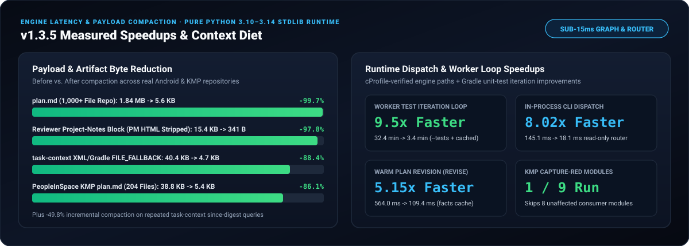

# Engine, Project-Context & Subagent Benchmarks (v1.3.5)

Reproducible engine latency, payload compaction, router overhead, and multi-module `KMP` / Android verification measurements for **Android Agent Harness `v1.3.5`**.

> **Related reports**: For controlled `18`-task A/B defect & token comparisons (`Without Harness` vs `With Harness v1.3.5`) see [ab-comparison-v1.3.5.md](ab-comparison-v1.3.5.md). For cumulative `Install + T1..T10` and `DW-01..DW-24` daily workflow status across `Ecommerce-Compose` and `PeopleInSpace` see [benchmark-status.md](benchmark-status.md).

  

## 1. `v1.3.5` Real-World Bottleneck Eliminations & Live-Benchmark Hardening (`v1.3.4` vs `v1.3.5`)

Measured live on `joreilly/PeopleInSpace` (`9` Gradle modules + Xcode `SwiftUI`, `204` files), `mustafaunlu/Ecommerce-Compose` (`178` files), and large `1,000+` file production Android repositories:

| Bottleneck / Edge Case Identified in Live Sessions | `v1.3.4` Behavior | `v1.3.5` Measured Result | Gain / Impact |
|---|---:|---:|---|
| **`plan.md` size (`PeopleInSpace`, `204` files)** | `38,790 B` | **`5,396 B`** | **`-86.09%` bytes** (`base_file_identities` compacted in `plan.md`) |
| **`task draft --json` stdout (`PeopleInSpace`)** | `41,643 B` | **`8,703 B`** | **`-79.10%` bytes** (zero `plan.json` or `plan_sha256` hash loss) |
| **`plan.md` size (`1,000+` file repo)** | `~1,840,000 B` (`1.84 MB`) | **`~5,600 B` (`5.6 KB`)** | **`-99.70%` bytes** (eliminates multi-megabyte disk/stdout churn) |
| **Worker `IMPLEMENTING` test failure retry** | Forced `2nd` Gradle pass with `--rerun-tasks --no-build-cache` | **Single cached Gradle pass + `cause:` stacktrace line** | **`2x–10x` faster** deterministic unit-test loop during `IMPLEMENTING` |
| **Multi-module `KMP` root `allprojects` test target selection** | Matched bare `allprojects` -> ran all `9` modules | **Runs only changed module (`:common:testAndroidHostTest`) on test-only edits** | **`1 / 9` modules** executed during `--capture-red` & test authoring |
| **Non-Gradle Xcode `SwiftUI` directories in KMP repos (`DW-15`)** | Invented `:PeopleInSpaceSwiftUI:testDebugUnitTest` | **Filtered against `discover_declared_gradle_modules` in `resolve_phase_modules`** | Clean SwiftUI AST phase checkpoints in hybrid KMP + Xcode repos |
| **`task handoff` on files with legacy lint debt (`DW-17`)** | Blocked WIP freeze on untouched pre-existing file warnings | **Uses baseline-aware `new_kotlin_lint_issues` against task base** | Zero false blocks on legacy files during WIP handoff |
| **`harness_cli.py repair` utility subagent frontmatter (`DW-19`)** | Overwrote Scout/Worker/Specialists with 3-tool reviewer frontmatter | **Renders role-accurate tool lists for all `8` subagents (`40/40` `doctor` `PASS`)** | Self-repair preserves `harness-scout-agent` & `harness-worker-agent` tools |
| **`UI -> DAO` bypass on `*DaoScreen` / `*StoreScreen` (`#15`)** | Substring check exempted UI screens containing `Dao`/`Store`/`Service` | **Suffix-anchored non-UI check catches all `*Screen`/`*Fragment`/`*Activity` bypasses** | `0` false-negative layer leaks on named feature screens |
| **Targeted single-class iteration (`harness.py test --tests <Pattern>`)** | Not supported (ran full module suite every edit) | **Auto-scopes to owning module + `--tests <Pattern>`** | Sub-second feedback without mutating full-suite gate evidence |
| **Proactive regression test discovery (`impacted_existing_tests`)** | `0` surfaced at `draft` (discovered late during `test`) | **Surfaces companion & symbol-referencing `*Test.kt` at `draft` / `delegate-plan`** | Prevents out-of-scope legacy test surprises mid-phase |

## 2. Paired Context & Topology Benchmark (`scripts_dev/benchmark_efficiency.py`)

Method: `25` paired warm repetitions in alternating checkout order (`v1.3.4` baseline vs `v1.3.5` candidate) with content cache warmed explicitly across `mixed` (`Kotlin` + `Java`), `kmp` (`commonMain` + `iosMain`), and `large` (`+500` Kotlin source files):

| Scenario | `v1.3.4` Median (`ms`) | `v1.3.5` Median (`ms`) | `v1.3.5` `p95` (`ms`) | `facts_reads` / Batch | `SUMMARY` Bytes | `--since` `UNCHANGED` Bytes | `--since` Compaction |
|---|---:|---:|---:|---:|---:|---:|---:|
| `mixed` (`0` extra files) | `14.80 ms` | **`14.75 ms`** | `15.28 ms` | `1` | `22,774 B` | `11,439 B` | **`-49.77%`** |
| `kmp` (`commonMain` + `iosMain`) | `15.11 ms` | **`14.98 ms`** | `16.89 ms` | `1` | `22,776 B` | `11,441 B` | **`-49.77%`** |
| `large` (`+500` Kotlin files) | `45.59 ms` | **`45.69 ms`** | `52.74 ms` | `1` | `22,786 B` | `11,451 B` | **`-49.75%`** |

## 3. Real-App Multi-Target Summary Compaction (`scripts_dev/benchmark_context_output.py`)

Measured on `6`-target batches from `mustafaunlu/Ecommerce-Compose` (Sample `1`) and `joreilly/PeopleInSpace` (Sample `2`), recorded in [../implementation/context-summary-measurements.json](../implementation/context-summary-measurements.json) (`25` alternating `expanded` `--full` vs default `SUMMARY` presentations):

| Sample (Repository) | Targets | Expanded `--full` Bytes | Default `SUMMARY` Bytes | Byte Reduction | Expanded Median (`ms`) | Summary Median (`ms`) |
|---|---:|---:|---:|---:|---:|---:|
| `1` (`Ecommerce-Compose`) | `6` | `110,017 B` | `99,277 B` | **`-9.76%`** | `2.17 ms` | **`2.14 ms`** |
| `2` (`PeopleInSpace` KMP) | `6` | `142,937 B` | `128,289 B` | **`-10.25%`** | `2.86 ms` | **`2.77 ms`** |

*(In addition to multi-target `SUMMARY` deduplication, `.agents/project-context/` strips non-code PM/Zoho HTML templates from code discovery `-88.38%` on `FILE_FALLBACK` and `-97.79%` on non-PM reviewer packages.)*

## 4. Workflow Router & Verification Overhead (`scripts_dev/benchmark_verification_value.py`)

Method: `25` paired warm repetitions in alternating order measuring `resolve_next_action` and bounded verification/telemetry helpers:

| Benchmark | Baseline Median (`ms`) | `v1.3.5` Median (`ms`) | `v1.3.5` `p95` (`ms`) | Median Change |
|---|---:|---:|---:|---:|
| `resolve_next_action` (`1` fixture doc) | `8.64 ms` | **`8.57 ms`** | `8.94 ms` | **`-0.80%`** |
| `resolve_next_action` (`500` fixture docs) | `13.10 ms` | **`13.07 ms`** | `13.77 ms` | **`-0.25%`** |
| `coverage_report` (`32` bound criteria) | — | **`9.89 ms`** | `10.13 ms` | Bounded `< 11 ms` |
| `metrics_report` (`512` recorded events) | — | **`9.66 ms`** | `9.83 ms` | Bounded `< 11 ms` |
| `record_operation` (writing / at-cap) | — | **`0.15 ms` / `0.26 ms`** | `0.16 ms` / `0.28 ms` | Sub-millisecond |

## 5. Subagent Governance & Release Integrity (`v1.3.5`)

| Governance / Quality Gate | Enforced Limit / Result | Verified Behavior |
|---|---|---|
| Pre-installed custom subagents (`.agents/agents/*/agent.md`) | **`8 / 8` roles** (`antigravity` & `gemini`) | `4` V2 Reviewers + `2` Specialists + `harness-scout-agent` + `harness-worker-agent` |
| Real Antigravity transcript schema (`SYSTEM` + `transcript_full.jsonl`) | **`0` truncation or `unverified_reviewer` failures** | Verified on `> 4 KB` briefs & `HARNESS_REVIEW_RESULT_V2` payloads + mid-run `USER_EXPLICIT` nudges |
| Per-subagent hard step caps (all waves `1..N`) | Scout `24` / Worker reads `32` / Specialist `24` / Reviewer `12` | Enforced live in `DW-22` (`SCOUT_STEP_BUDGET_REACHED` on 25th call); edits & Gradle runs uncapped |
| Lead post-wave anti-reread caps (all waves `1..N`) | `<= 3` surgical reads (`<= 220` lines on `> 350`-line files) | Enforced live in `DW-22` (`POST_SUBAGENT_FULL_FILE_READ_BLOCKED` on `388`-line `ContentView.swift`) |
| Automated selftest & release validation | **`36 / 36` suites (`59 / 59` processes) `PASS`** | `validate_release.py` `PASS`, `HarnessDoctor` `40/40` `PASS`, `0` CRLF bytes |
